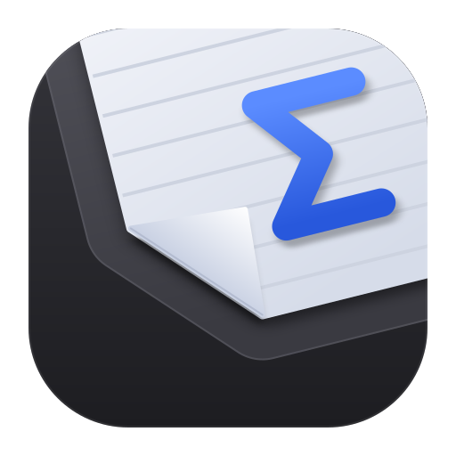

<p align="center"></p>

# Moss

A local-first LaTeX editor for Windows. It compiles on your PC with your own TeX install, syncs with Overleaf, and exposes your projects to AI agents through an MCP server.

> **Beta.** Releases are unsigned, so Windows SmartScreen may warn. Choose **More info**, then **Run anyway**.

## Install

Download `Moss_*_x64-setup.exe` from the [latest release](../../releases). It installs per user and needs no admin rights. On first run Moss offers to install MiKTeX and a portable Perl for you.

## Build from source

Needs Rust, Node 22 and the Tauri prerequisites for Windows.

```
npm ci && npm ci --prefix ui
npm run tauri dev
cargo test -p moss-core
```

See `CLAUDE.md`, `GLOSSARY.md`, `docs/ROADMAP.md` and `docs/adr/` for how the project is laid out.

## Platforms

Windows only for now.

## License

[MIT](LICENSE)
