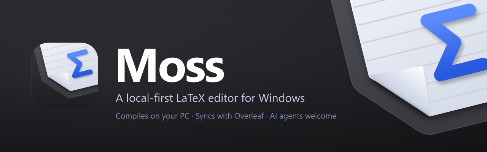

<p align="center">
  
</p>

<p align="center">
  <a href="https://github.com/EthanRodrigues001/moss/releases"></a>
  <a href="https://github.com/EthanRodrigues001/moss/releases"></a>
  <a href="LICENSE"></a>
  <a href="https://github.com/EthanRodrigues001/moss/actions/workflows/ci.yml"></a>
  <a href="#install"></a>
  <a href="https://tauri.app"></a>
</p>

<p align="center">
  <b>Moss</b> is a LaTeX editor that keeps your projects as plain folders on your PC and compiles them with your own TeX install.<br/>
  It syncs with Overleaf, and an MCP server lets AI agents read, edit and compile the same projects.
</p>

<p align="center">
  <a href="#install">Install</a> ·
  <a href="#features">Features</a> ·
  <a href="#ai-agents">AI agents</a> ·
  <a href="#privacy">Privacy</a> ·
  <a href="#develop">Develop</a> ·
  <a href="#credits-and-licence">Licence</a>
</p>

---

## Why Moss

Online editors are convenient until you are offline, over a free plan's compile limit, or want an AI agent to work on the real files. Moss keeps everything on your machine and still lets you sync with Overleaf when you want to.

- **Your files, on your disk.** A Project is an ordinary folder. No account, no server, no lock-in.
- **Your TeX.** It compiles with the MiKTeX or TeX Live you already have, or installs MiKTeX for you in one click.
- **Safe for agents.** Every agent change takes a restore point first, and deleting files waits for your Approval.

Moss does not host anything, run a cloud compiler, or use Overleaf's official API (Overleaf has none on the free plan). It is Windows only.

> [!NOTE]
> **Status:** beta, version 0.1.0-beta.1. Overleaf sync is built and tested against a stand-in folder, but **not yet checked against a live Overleaf account**, and it uses Overleaf's unofficial web session, so Overleaf changing its site can break it. The one-click LaTeX setup has not yet been run on a clean PC.

## Install

Moss is for **Windows** (x64).

1. Download **`Moss_0.1.0-beta.1_x64-setup.exe`** from the [latest release](https://github.com/EthanRodrigues001/moss/releases/latest).
2. Run it. It installs for your account only and needs no admin rights.
3. On first run Moss checks for TeX. If none is found, **Set up LaTeX** downloads MiKTeX (about 150 MB) and a portable Perl, checks each download against a pinned SHA-256, and compiles a test document.

> [!IMPORTANT]
> The installer is not code-signed yet, so Windows SmartScreen may say "Windows protected your PC". Choose **More info**, then **Run anyway**.

Moss checks GitHub for updates. A new release shows an update button in the sidebar and a page under **Settings → Updates**. Updates are signed and verified before they install.

## Features

- **Compile.** `latexmk` with pdfLaTeX (the default), XeLaTeX or LuaLaTeX, a persistent build cache, and errors you can click to jump to. A PDF is shown even when the document has errors.
- **Editor.** Monaco with LaTeX and BibTeX highlighting and live lint, a visual (Tiptap) editor, and an equation editor (MathLive).
- **PDF preview.** Lazy pages, zoom, fit width, and SyncTeX both ways: Ctrl+Shift+J jumps from source to PDF, double-click goes back.
- **Projects.** Import a zip or folder, start from a template (article, paper, report, thesis, beamer, letter, cv, unicode), search and replace across files (Ctrl+Shift+F).
- **History.** Every change, yours or an agent's, is a restore point. Save named versions, compare any two, restore a file or the whole project.
- **Overleaf sync.** Link a project, then Review, Pull, Push or Sync. Edits to different lines merge on their own; edits to the same lines open a conflict screen with Mine, Theirs or Both.
- **Setup and tour.** One-click MiKTeX and Perl install, and a **Moss tour** project that compiles with citations so you can see it work.

## AI agents

`moss-mcp` is a separate program that speaks the Model Context Protocol over stdio. It installs next to Moss and exposes 46 tools: read, edit and write files, compile with structured diagnostics, view pages as images, undo and redo, and the Overleaf operations above.

**Settings → MCP** shows which of Claude Code, Claude Desktop, Cursor and Codex are set up, gives copy-paste config for the rest, and lets you switch any tool off.

- Deleting files and turning on shell-escape wait for your **Approve** click in the app, unless you mark the project Trusted.
- Pushing or syncing to Overleaf asks the same way.
- Every agent action is written to `.moss/audit.log` in the project.

## Privacy

Everything stays on your PC. Moss makes network calls only for:

- **Overleaf**, when you sign in and sync (`www.overleaf.com`). Your session is kept in the Windows Credential Manager.
- **Setup**, when you choose it: MiKTeX from `miktex.org` and Perl from GitHub.
- **Updates**, a check against this repository's GitHub releases.

There is no analytics and no telemetry.

## Develop

Needs Rust 1.90 or newer, Node 22 and the [Tauri prerequisites](https://tauri.app/start/prerequisites/) for Windows.

```bash
npm ci && npm ci --prefix ui
npm run tauri dev        # run the app
cargo test -p moss-core  # core tests
```

```bash
cd ui && npx next typegen && npx tsc --noEmit && npm run lint
node scripts/bump-version.mjs <version>   # keeps all four version fields equal
```

- `crates/moss-core/`: everything that is not UI: workspace, compile, history, sync, Overleaf client, setup.
- `crates/moss-mcp/`: the MCP server, built on the same core.
- `src-tauri/`: the Tauri app and its commands.
- `ui/`: static-export Next.js, shadcn/ui, Monaco, Tiptap.
- `docs/`: roadmap, phases and `adr/` for decisions that are hard to reverse. `GLOSSARY.md` has the project's terms.

A `v*` tag builds the installer in GitHub Actions and publishes a pre-release; the in-app updater reads `latest.json` from the `updater` release.

Bugs and ideas go in [Issues](https://github.com/EthanRodrigues001/moss/issues). See [CONTRIBUTING.md](CONTRIBUTING.md).

## Credits and licence

Moss is licensed under the [MIT License](LICENSE).

- The interface uses [shadcn/ui](https://ui.shadcn.com), [Monaco](https://github.com/microsoft/monaco-editor), [Tiptap](https://tiptap.dev), [MathLive](https://cortexjs.io/mathlive/), [PDF.js](https://mozilla.github.io/pdf.js/) and the [dithercn](https://dithercn.dev) Aurora and Contours components.
- Compilation uses your own [MiKTeX](https://miktex.org) or TeX Live; the optional setup downloads MiKTeX Basic and [Strawberry Perl](https://strawberryperl.com) from their publishers.
- Badges by [shieldcn](https://shieldcn.dev).

Overleaf, MiKTeX, Claude, Cursor and Codex belong to their owners; Moss is not affiliated with or endorsed by them.
